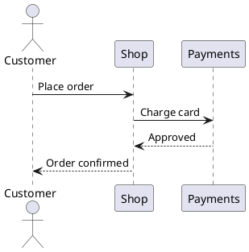
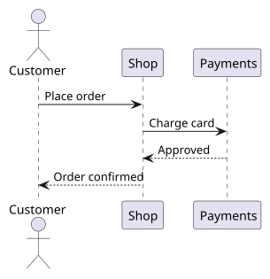

[PlantUML](https://plantuml.com/) draws diagrams from text. Instead of
dragging boxes around an editor, you write `Customer -> Shop: Place order`
and PlantUML lays out the sequence diagram for you. Markdown is where most
documentation lives. Put the two together and the diagram's source sits in
the same file as the text that explains it: it is reviewed in the same pull
request, searched with the same tools, and never drifts away from the
document because someone lost the original drawing.

This tutorial shows how: write the diagram inside the Markdown file, run
PlantUML on that file to generate an image, and link the image from the
document. The approach comes from a gist by Noam Tamim.[^tamim] Every
command below was run with PlantUML 1.2026.9 on OpenJDK 17, on 21 October
2026, and the GitHub behaviour was checked against GitHub's own Markdown
renderer the same day.

## Step 1: Install PlantUML

PlantUML is a Java program, distributed as a single `.jar` file. It needs
Java installed; the project recommends Java 11 or later.[^starting] Check
with:

```bash
java -version
```

Then get PlantUML itself:

- **Any platform:** download `plantuml-<version>.jar` from the project's
  [GitHub releases](https://github.com/plantuml/plantuml/releases) and run it
  with `java -jar plantuml.jar`. That is what the commands below use.
- **macOS and Linux with Homebrew:** `brew install plantuml` installs a
  `plantuml` command along with Java and Graphviz.[^brew] Anywhere this
  tutorial writes `java -jar plantuml.jar`, `plantuml` does the same.

Some diagram types, among them class, component, state and use case
diagrams, are laid out with Graphviz. Sequence diagrams, like the one in this
tutorial, do not need it. On Windows, PlantUML has shipped with a minimal
Graphviz since version 1.2020.21, so nothing else needs installing; on
Linux, install Graphviz from the distribution's packages.[^graphviz]

## Step 2: Write the diagram inside the Markdown file

PlantUML does not care what kind of file it reads. Give it any text file
and it looks for blocks that start with `@startuml` and end with `@enduml`,
and draws one image per block.[^commandline] So the diagram source can sit
in the Markdown file itself, as long as two things are true:

- **The block is named.** Whatever follows `@startuml` on the same line
  becomes the image's file name: `@startuml checkout-sequence` produces
  `checkout-sequence.svg`.[^sources] Without a name, the image is named
  after the Markdown file, and a second diagram in the same file gets a
  sequence number added, which makes links fragile.
- **The document links the image.** A normal Markdown image with the same
  name, ``, shows the diagram
  once it has been generated.

That leaves the question of what readers see where the source is. The
cleanest answer is a collapsible block: the diagram is on the page, and its
source is one click away for whoever wants to change it.

````markdown
# Checkout

When a customer places an order, the shop charges the card before
confirming:

<details>
<summary>Diagram source</summary>



</details>


````

`<details>` and `<summary>` are plain HTML, which Markdown passes through,
and GitHub renders them as a collapsed section with the source
syntax-highlighted inside. The blank lines around the fenced block matter:
without them, Markdown treats the fence as part of the HTML and shows it as
raw text.

## Step 3: Generate the images

Run PlantUML on the Markdown file, asking for SVG output:

```bash
java -jar plantuml.jar -tsvg checkout.md
```

PlantUML writes `checkout-sequence.svg` next to the Markdown file, one SVG
per `@startuml` block. The newer spelling `--svg` does the same, and `-o`
puts the images in another directory, relative to the source
file:[^commandline]

```bash
java -jar plantuml.jar -tsvg -o diagrams checkout.md
```

If you use `-o`, link the images with the same folder,
``. SVG is the better
format for documentation: it stays sharp at any zoom, and it is text, so a
changed diagram shows up as a readable diff.

The result:


Run the command again whenever the diagram changes. The SVG is a build
output that is committed alongside the document, so it is worth checking
the source in CI: `java -jar plantuml.jar --check-syntax checkout.md` draws
nothing, reports the line of any error, and exits with a non-zero status
(200) when a diagram is broken, which fails the build.[^commandline]

## Step 4: Publish

Commit the Markdown file and the generated SVGs together. GitHub, GitLab and
most documentation sites render the Markdown and load the images by their
relative paths, so nothing else is needed. To produce HTML locally, any
Markdown converter will do, and the images come along because they are
ordinary image links.

## The HTML comment trick, and why it breaks

The original gist, and many copies of it, hide the source in an HTML comment
instead of a `<details>` block:

```markdown
<!--
@startuml first-diagram
Alice -> Bob: Hello
Bob -> Alice: Hi!
@enduml
-->


```

PlantUML still finds the block, and the comment hides it from readers. It
works for this example. It fails as soon as the diagram contains `-->`,
which in PlantUML is the ordinary dashed arrow, used for every reply in a
sequence diagram. In Markdown, an HTML comment ends at the first line that
contains `-->`,[^commonmark] so the comment closes in the middle of the
diagram and the rest of the source appears on the page as text. Running the
checkout example above through GitHub's renderer with a comment in place of
`<details>` shows exactly that: the comment ends at
`Payments --> Shop: Approved`, and everything after the arrow, from
`Shop: Approved` down to `@enduml` and the real closing `-->`, appears as a
paragraph above the image.

A later version of the gist wraps the source in `<div hidden>` instead. That
avoids the comment problem, but GitHub removes the `hidden` attribute when
it renders Markdown, so on GitHub the source is shown anyway.

The comment trick is safe only for diagrams with no `-->` in them. The
`<details>` block works for every diagram, and it is the one I use.

## Alternatives

- **Keep the source in its own file.** A `checkout-sequence.puml` next to
  the document, with only the image link in the Markdown, avoids every
  rendering question. The cost is a second file to keep in step with the
  text.
- **Mermaid on GitHub.** GitHub renders Mermaid diagrams written in a
  ` ```mermaid ` fenced block directly, with no generated image at all.
  PlantUML is not among the formats it renders.[^githubdiagrams] For a
  repository that only needs flowcharts or sequence diagrams on GitHub,
  Mermaid is less work; PlantUML covers more diagram types and renders
  the same everywhere because the output is a plain image.

## References

[^tamim]: Tamim, N. (2019). *How to use PlantUML with Markdown* [GitHub Gist]. <https://gist.github.com/noamtamim/f11982b28602bd7e604c233fbe9d910f>

[^starting]: PlantUML. (n.d.). Quick start guide. <https://plantuml.com/starting>

[^brew]: Homebrew. (n.d.). plantuml. In *Homebrew Formulae*. <https://formulae.brew.sh/formula/plantuml>

[^graphviz]: PlantUML. (n.d.). Installing Graphviz. <https://plantuml.com/graphviz-dot>

[^commandline]: PlantUML. (n.d.). Command line. <https://plantuml.com/command-line>

[^sources]: PlantUML. (n.d.). Sources. <https://plantuml.com/sources>

[^commonmark]: MacFarlane, J. (2024). HTML blocks. In *CommonMark Spec* (Version 0.31.2). <https://spec.commonmark.org/0.31.2/#html-blocks>

[^githubdiagrams]: GitHub. (n.d.). Creating diagrams. In *GitHub Docs*. <https://docs.github.com/en/get-started/writing-on-github/working-with-advanced-formatting/creating-diagrams>
